# NB Sound Mobile

<p align="center">
  
</p>

<p align="center">
  <strong>Tu propia biblioteca de música, del PC al teléfono. Por tu red local, y por ningún otro sitio.</strong>
</p>

<p align="center">
  <a href="LICENSE"></a>
  
  
  
  
</p>

<p align="center">
  <a href="README.md">English</a> · <strong>Español</strong>
</p>

---

## En resumen

NB Sound Mobile es el acompañante gratuito y de código abierto de [NB Sound](https://github.com/nb-digital-hq/nb-sound)
en el teléfono. Escanea un QR en tu PC y tu biblioteca (álbumes, artistas, playlists, portadas, letras sincronizadas
e instrumentales de karaoke) llega al teléfono por tu Wi-Fi. Escúchala en segundo plano, descárgala para oírla sin
conexión, o convierte el teléfono en el mando de tu PC y pasa la música de uno a otro sin perder el punto. Sin
cuenta, sin nube, sin telemetría. Forma parte de la suite comunitaria de NB Digital, con licencia Apache 2.0.

## Funciones

| Área | Qué ofrece |
|---|---|
| **Emparejamiento y sincronización** | QR o dirección y código, certificado del PC fijado por su huella, sincronización delta paginada por la red local |
| **Biblioteca** | Inicio con secciones según tu historial, búsqueda tolerante a errores, álbumes, artistas y pistas con orden y vistas, playlists del PC y propias |
| **Reproducción** | En segundo plano, cola con "a continuación", aleatorio, repetición, autoplay, letra sincronizada, karaoke, velocidad, temporizador, controles en la notificación y la pantalla de bloqueo |
| **Reproducir en el PC** | Control completo del reproductor del PC y traspaso en ambos sentidos de cola, pista y posición; las teclas de volumen del teléfono mandan sobre el PC |
| **Sin conexión** | Descargas completas (audio, portada, letra, instrumental), playlists guardadas al día y copia completa opcional |
| **Música del teléfono** | La música guardada en el teléfono aparece junto a la del PC (Android) |
| **Personalización** | 63 temas, ecualizador, ícono alternativo y tres widgets de pantalla de inicio (Android) |
| **Idiomas** | Español, inglés y portugués |

## Garantías de privacidad

Las garantías las hacen cumplir el código y comprobaciones automáticas; la declaración completa está en
[PRIVACY.md](PRIVACY.md) y en [privacidad](docs/audit/privacy.md).

* **Cero telemetría y cero registros.** Sin analítica, sin informes de fallos, sin seguimiento, sin archivos de
  registro.
* **Una salida de red, dos destinos.** Toda conexión se construye en `lib/core/network/`: el PC que emparejaste y,
  solo cuando pulsas "Buscar actualizaciones" en Android, GitHub. Un cliente en cualquier otro sitio hace fallar las
  comprobaciones.
* **Sin cuenta ni nube.** Tu música no sale de tu red.
* **Secretos en el llavero.** El token de emparejamiento y la huella del PC viven en el Keystore de Android o el
  Keychain de iOS.

## Arquitectura de un vistazo

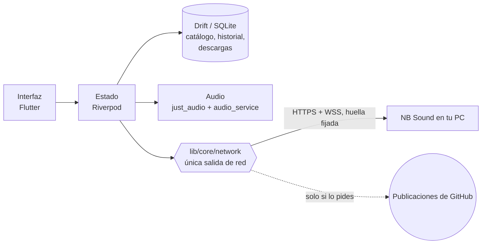

Más detalle en [docs/architecture](docs/architecture/README.md).

## Capturas y video

[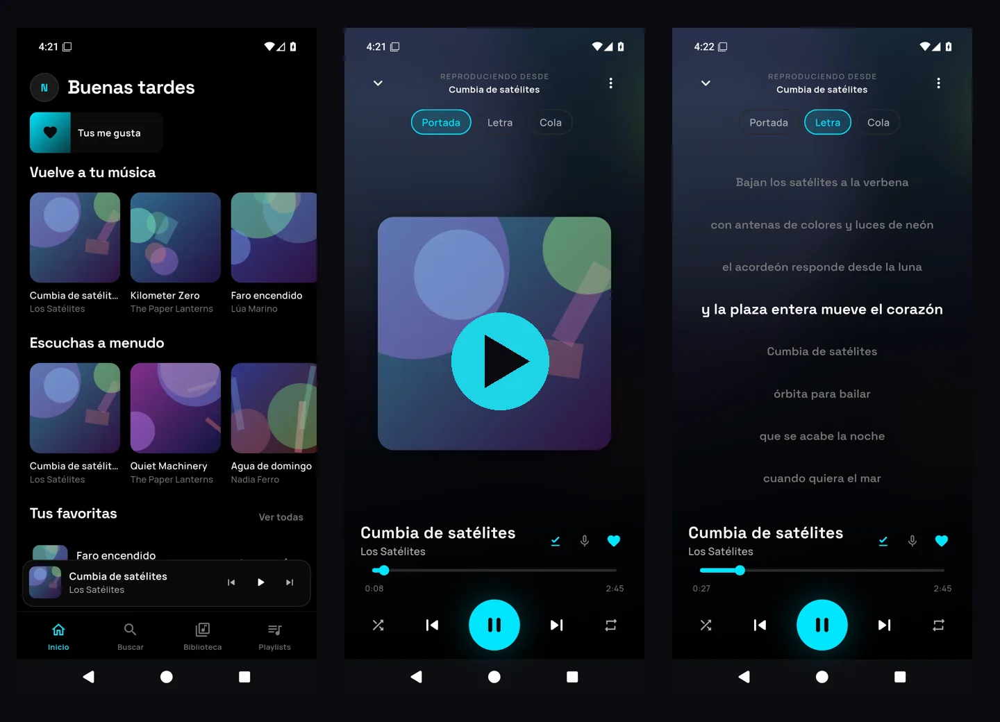](docs/assets/video/nb-sound-mobile-demo-es.mp4)

*Un recorrido corto grabado en la propia app ([MP4](docs/assets/video/nb-sound-mobile-demo-es.mp4)).*

| Inicio | Buscar | Biblioteca |
|---|---|---|
| 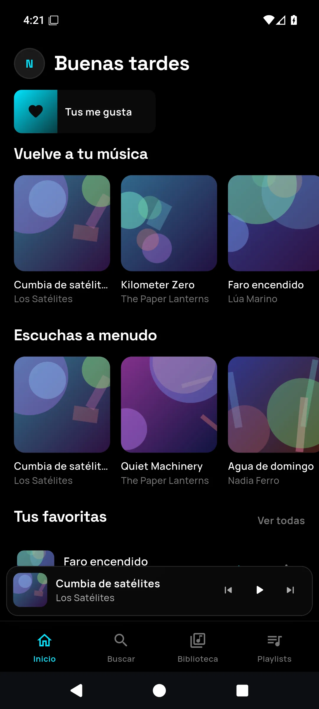 | 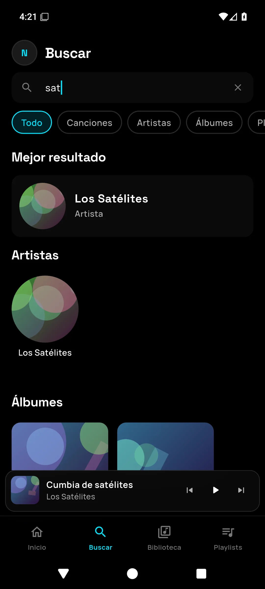 | 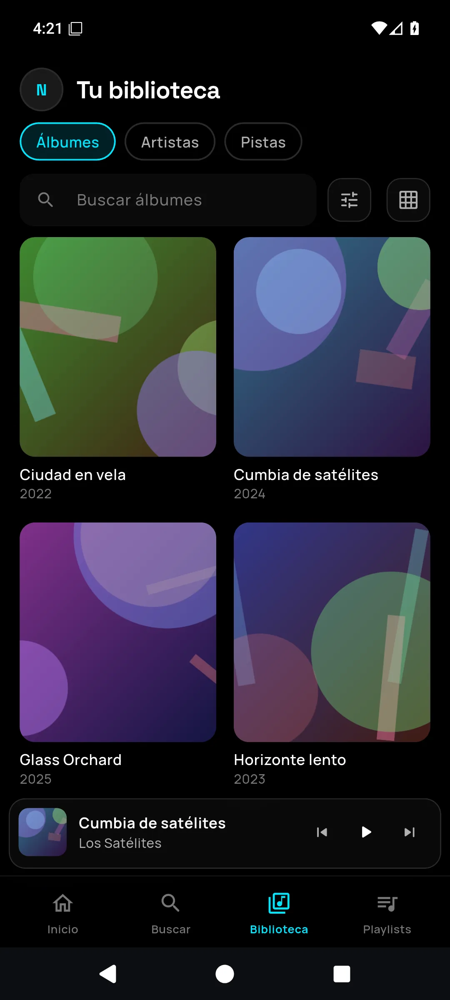 |

| Álbum | Reproductor | Letra |
|---|---|---|
| 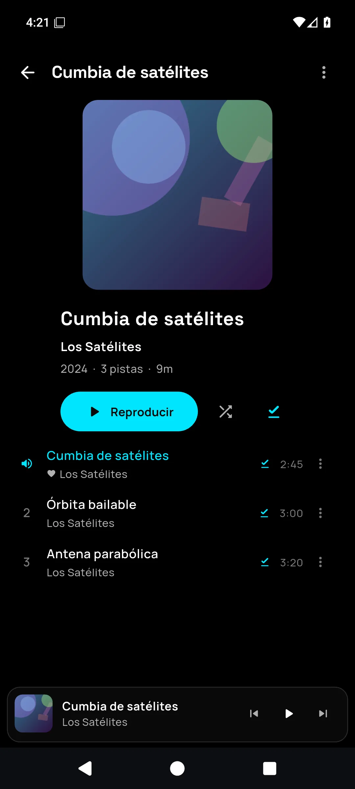 | 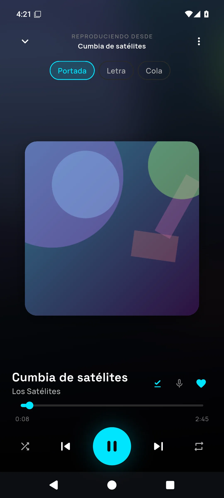 | 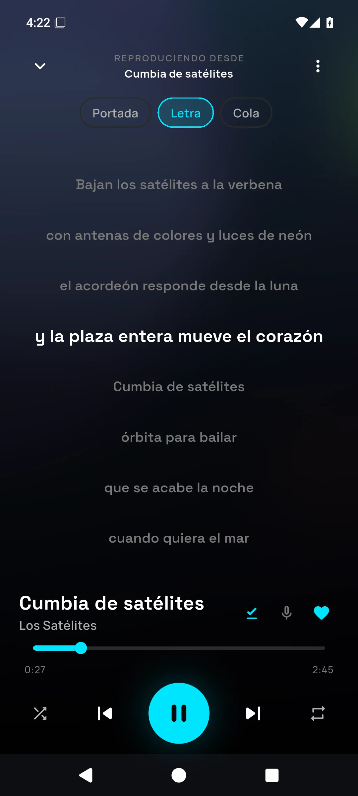 |

| Cola | Descargas | Temas |
|---|---|---|
| 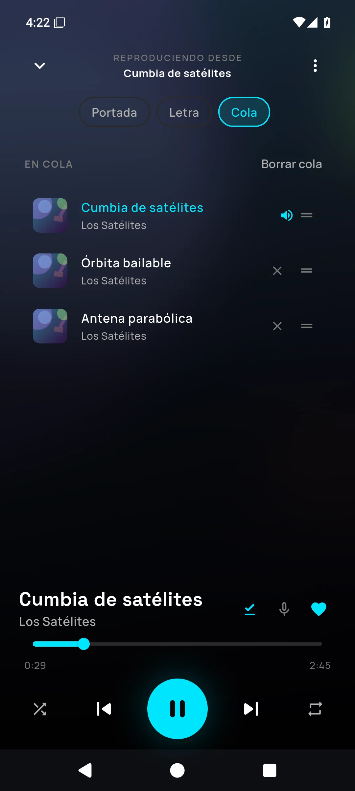 | 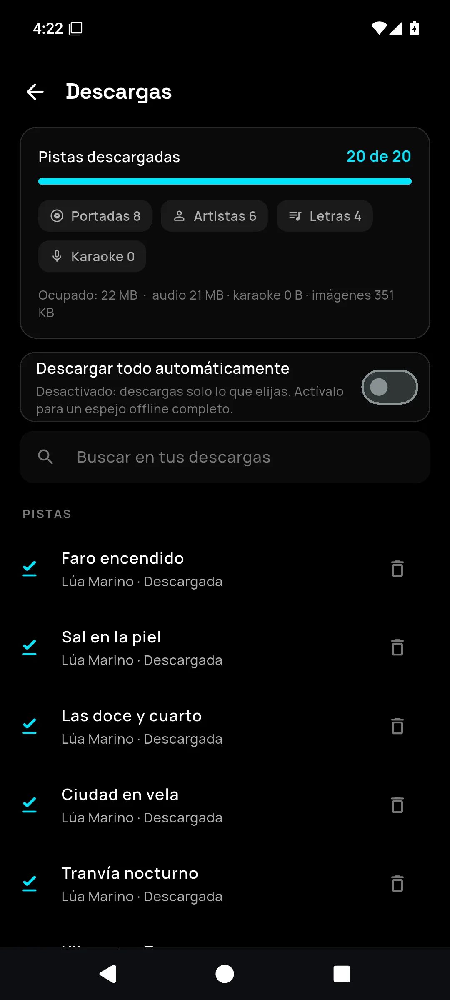 | 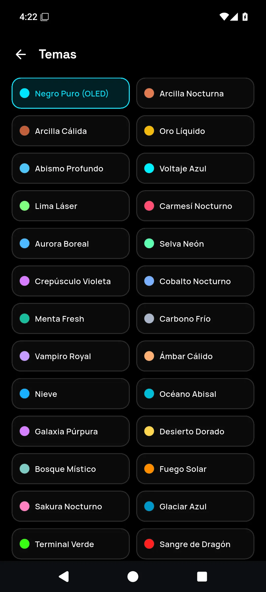 |

Los artistas, álbumes, portadas, audio y letras de estas imágenes son ficticios y los genera la edición de
demostración de la app.

## Instalación rápida

Descarga desde la página de publicaciones y comprueba con `SHA256SUMS` y su firma Ed25519 `SHA256SUMS.sig` (ver
[cadena de suministro](docs/audit/supply-chain.md)).

| Dispositivo | Paquete |
|---|---|
| Casi todos los teléfonos Android (64 bits) | `NB-Sound-Mobile-1.0.0-arm64-v8a.apk` |
| Teléfonos Android antiguos de 32 bits | `NB-Sound-Mobile-1.0.0-armeabi-v7a.apk` |
| Emuladores, Chromebook con Intel o AMD | `NB-Sound-Mobile-1.0.0-x86_64.apk` |
| Cualquier dispositivo Android | `NB-Sound-Mobile-1.0.0-universal.apk` |
| iPhone y iPad | `NB-Sound-Mobile-1.0.0-ios-unsigned.ipa` (**sin probar**) |

Android 7.0 o posterior es la plataforma verificada. La edición de iOS se publica **sin probar en un dispositivo
real** y sin firma de Apple: hay que firmarla para instalarla, e iOS mostrará avisos. La música del teléfono, el
ecualizador, el ícono alternativo, los widgets y el actualizador son solo de Android. Los informes desde iOS son
bienvenidos.

Necesitas además [NB Sound](https://github.com/nb-digital-hq/nb-sound) 1.0 o posterior en tu PC, en la misma red.

Para compilar desde el código:

```bash
just setup      # flutter pub get y código generado
just demo       # con la biblioteca ficticia de demostración, sin PC
just apk
```

Detalles: [puesta en marcha](docs/developer/setup.md).

## Documentación

| Si quieres... | Lee |
|---|---|
| Usar la aplicación | [Manual de uso](docs/user/README.md) |
| Evaluarla para una institución | [Instituciones](docs/institution/README.md) |
| Entender cómo está hecha | [Arquitectura](docs/architecture/README.md) |
| Saber por qué está hecha así | [ADR](docs/adr/README.md) |
| Contribuir | [CONTRIBUTING.md](CONTRIBUTING.md) y [guía de desarrollo](docs/developer/README.md) |
| Trabajar con un agente de IA | [AGENTS.md](AGENTS.md) |

## Contribuciones, seguridad y conducta

Las contribuciones son bienvenidas con el certificado de origen del desarrollador (`git commit -s`); ver
[CONTRIBUTING.md](CONTRIBUTING.md). Las vulnerabilidades se reportan en privado como indica
[SECURITY.md](SECURITY.md). La participación se rige por el [Código de conducta](CODE_OF_CONDUCT.md).

## Licencia y marcas

Apache License 2.0; ver [LICENSE](LICENSE) y [NOTICE](NOTICE). Los nombres "NB", "NB Digital", "NB Sound" y "NB
Sound Mobile" y sus logotipos no se licencian bajo Apache 2.0; ver [TRADEMARKS.md](TRADEMARKS.md). Para citar el
proyecto, usa [CITATION.cff](CITATION.cff).
