# NB Sound Mobile

<p align="center">
  
</p>

<p align="center">
  <strong>Your own music library, from your PC to your phone. Over your local network, and nowhere else.</strong>
</p>

<p align="center">
  <a href="LICENSE"></a>
  
  
  
  
</p>

<p align="center">
  <strong>English</strong> · <a href="README.es.md">Español</a>
</p>

---

## TL;DR

NB Sound Mobile is the free, open-source phone companion of [NB Sound](https://github.com/nb-digital-hq/nb-sound).
Scan a QR code on your PC and your library (albums, artists, playlists, covers, synced lyrics and karaoke
instrumentals) comes to your phone over your Wi-Fi. Play it in the background, download it to listen offline, or
turn the phone into the remote of your PC and move the music between both without losing your place. No account,
no cloud, no telemetry. It is part of the NB Digital community suite, under the Apache 2.0 licence.

## Features

| Area | What you get |
|---|---|
| **Pairing and sync** | QR or address-and-code pairing, PC certificate pinned by fingerprint, paginated delta sync over the local network |
| **Library** | Home sections from your history, typo-tolerant search, albums, artists and tracks with sorting and views, PC and phone playlists |
| **Playback** | Background playback, queue with "play next", shuffle, repeat, autoplay, synced lyrics, karaoke, speed, sleep timer, lock screen and notification controls |
| **Play on your PC** | Full control of the PC player and two-way handoff of queue, track and position; phone volume keys drive the PC |
| **Offline** | Complete downloads (audio, cover, lyrics, instrumental), saved playlists kept up to date, optional full mirror |
| **Phone music** | Music stored on the phone appears next to the PC library (Android) |
| **Personalisation** | 63 themes, equalizer, alternative app icon and three home-screen widgets (Android) |
| **Languages** | Spanish, English and Portuguese |

## Privacy guarantees

These guarantees are enforced by code and by automated checks; the full statement is in [PRIVACY.md](PRIVACY.md).

* **Zero telemetry and zero logs.** No analytics, no crash reporting, no usage tracking, no log files.
* **One network exit, two destinations.** Every connection is built in `lib/core/network/`: the PC you paired and,
  only when you tap "Check for updates" on Android, GitHub. Any client elsewhere fails the checks.
* **No account, no cloud.** Your music never leaves your network.
* **Secrets in the keychain.** The pairing token and the PC fingerprint live in Android Keystore or iOS Keychain.

## Architecture at a glance

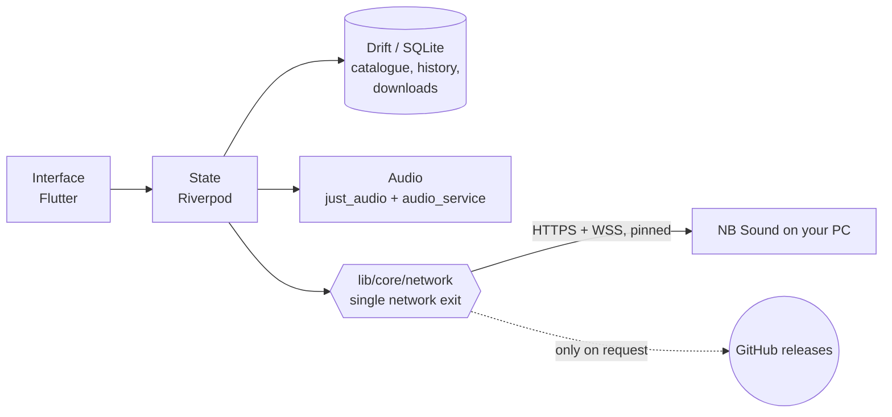

More detail in [docs/architecture](docs/architecture/README.md) (Spanish).

## Screenshots and video

[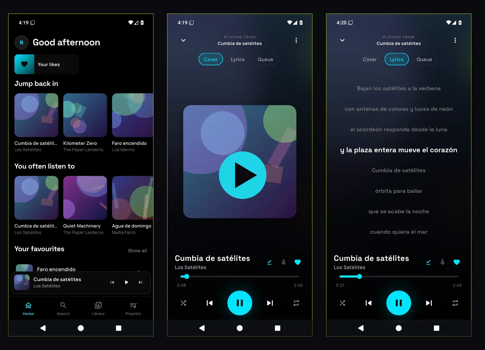](docs/assets/video/nb-sound-mobile-demo.mp4)

*A short tour recorded on the app itself ([MP4](docs/assets/video/nb-sound-mobile-demo.mp4)).*

| Home | Search | Library |
|---|---|---|
| 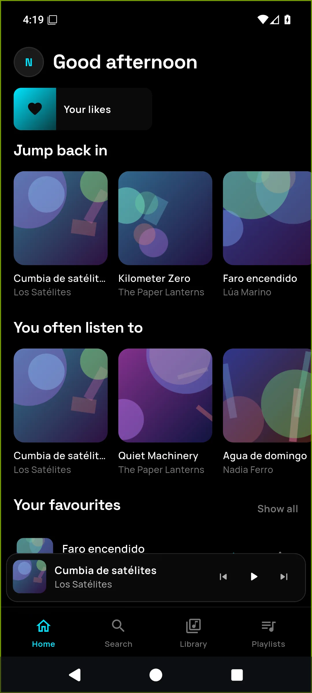 | 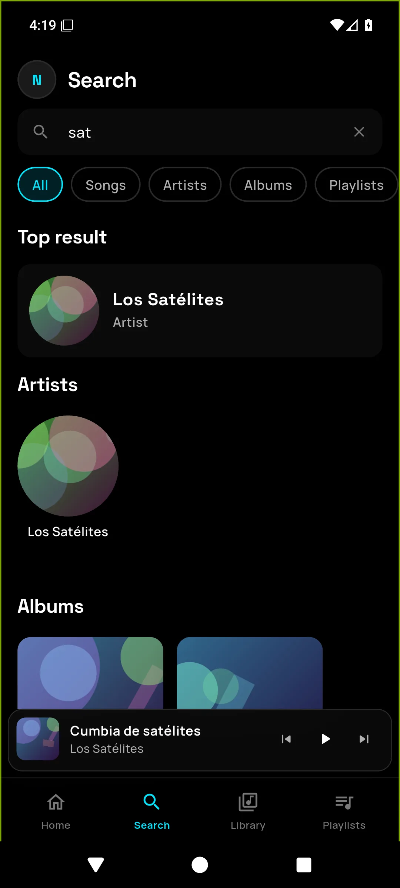 | 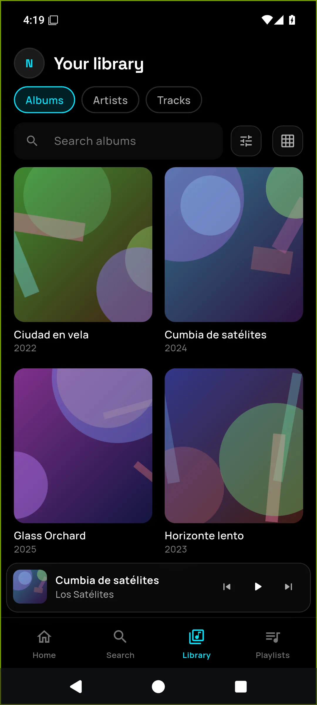 |

| Album | Player | Lyrics |
|---|---|---|
| 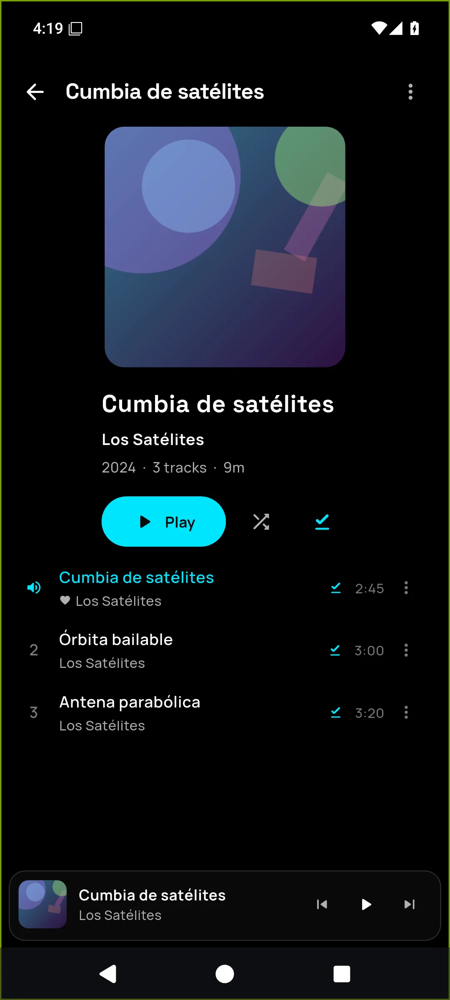 | 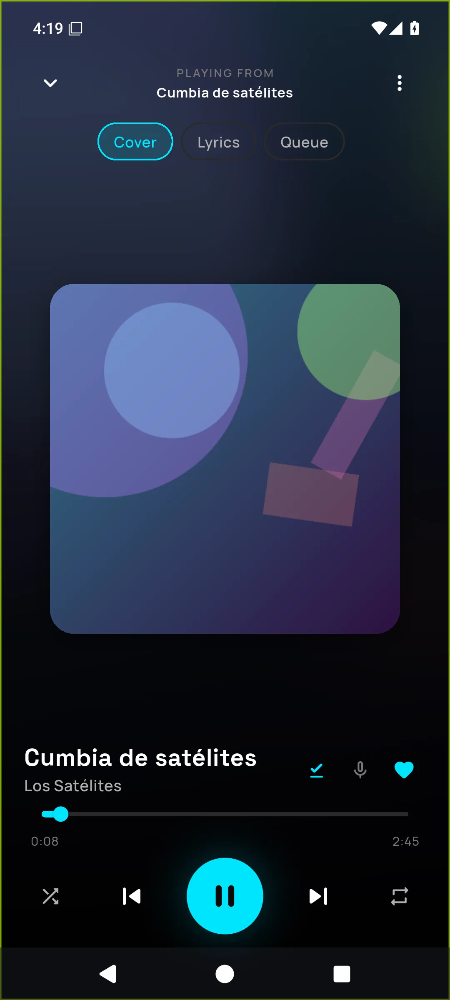 | 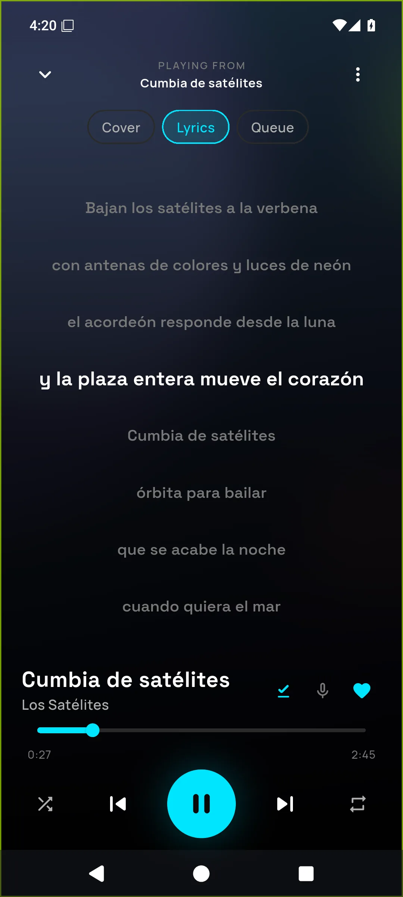 |

| Queue | Downloads | Themes |
|---|---|---|
| 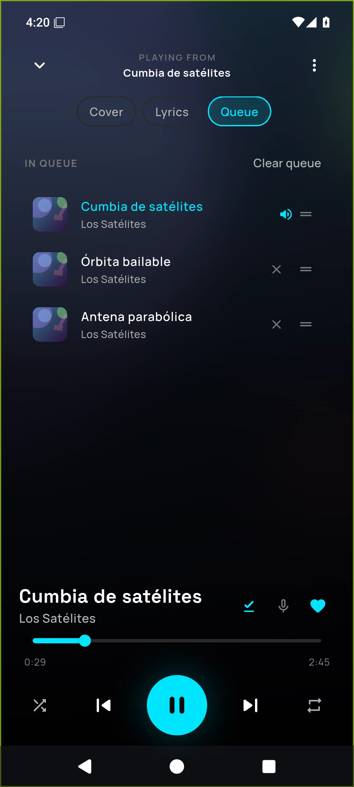 | 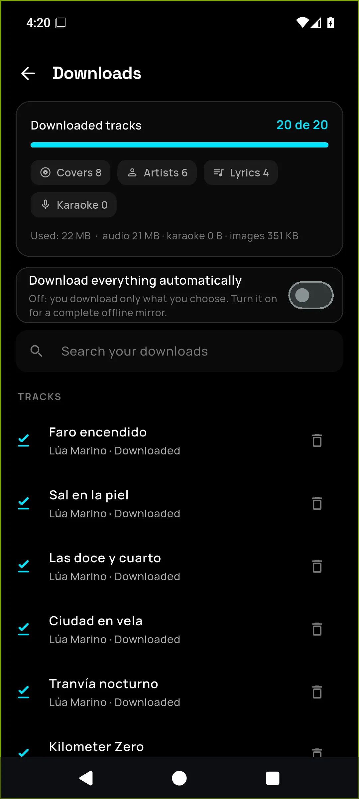 | 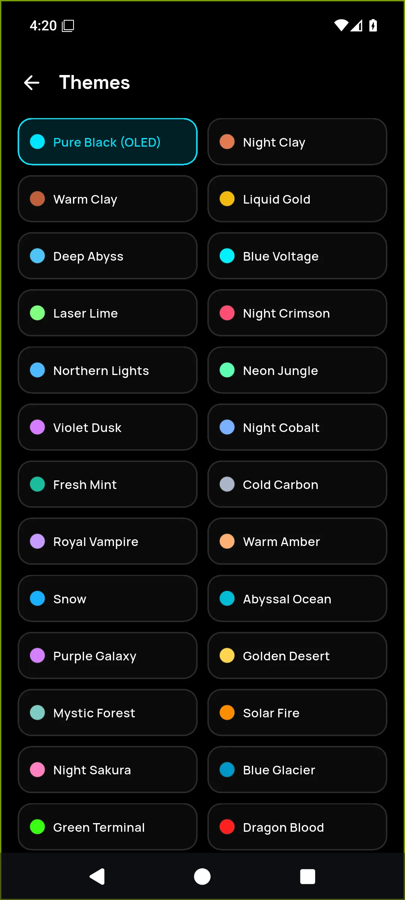 |

The artists, albums, covers, audio and lyrics in these images are fictional and generated by the app's demo
edition.

## Quick install

Download from the release page and verify against `SHA256SUMS` and its Ed25519 signature `SHA256SUMS.sig` (see
[supply chain](docs/audit/supply-chain.md)).

| Device | Package |
|---|---|
| Most Android phones (64-bit) | `NB-Sound-Mobile-1.0.0-arm64-v8a.apk` |
| Older 32-bit Android phones | `NB-Sound-Mobile-1.0.0-armeabi-v7a.apk` |
| Android emulators, Intel/AMD Chromebooks | `NB-Sound-Mobile-1.0.0-x86_64.apk` |
| Any Android device | `NB-Sound-Mobile-1.0.0-universal.apk` |
| iPhone and iPad | `NB-Sound-Mobile-1.0.0-ios-unsigned.ipa` (**untested**) |

Android 7.0 or later is the verified platform. The iOS build is published **untested on a real device** and
without an Apple signature: you need to sign it yourself to install it, and iOS will warn about it. Phone music,
equalizer, alternative icon, widgets and the in-app updater are Android-only. Reports from iOS are welcome.

You also need [NB Sound](https://github.com/nb-digital-hq/nb-sound) 1.0 or later on your PC, on the same network.

To build from source:

```bash
just setup      # flutter pub get + code generation
just demo       # run with the fictional demo library, no PC needed
just apk
```

Details: [developer setup](docs/developer/setup.md).

## Documentation

| If you want to... | Read |
|---|---|
| Use the application | [User guide](docs/user/README.md) |
| Evaluate it for an institution | [Institution](docs/institution/README.md) |
| Understand how it is built | [Architecture](docs/architecture/README.md) |
| Know why it is built this way | [ADR](docs/adr/README.md) |
| Contribute | [CONTRIBUTING.md](CONTRIBUTING.md) and [developer guide](docs/developer/README.md) |
| Work on it with an AI agent | [AGENTS.md](AGENTS.md) |

## Contributing, security and conduct

Contributions are welcome under the Developer Certificate of Origin (`git commit -s`); see
[CONTRIBUTING.md](CONTRIBUTING.md). Report vulnerabilities privately as described in [SECURITY.md](SECURITY.md).
Participation is governed by the [Code of Conduct](CODE_OF_CONDUCT.md).

## Licence and trademarks

Apache License 2.0; see [LICENSE](LICENSE) and [NOTICE](NOTICE). The names "NB", "NB Digital", "NB Sound" and "NB
Sound Mobile" and their logos are not licensed under Apache 2.0; see [TRADEMARKS.md](TRADEMARKS.md). To cite the
project, use [CITATION.cff](CITATION.cff).
